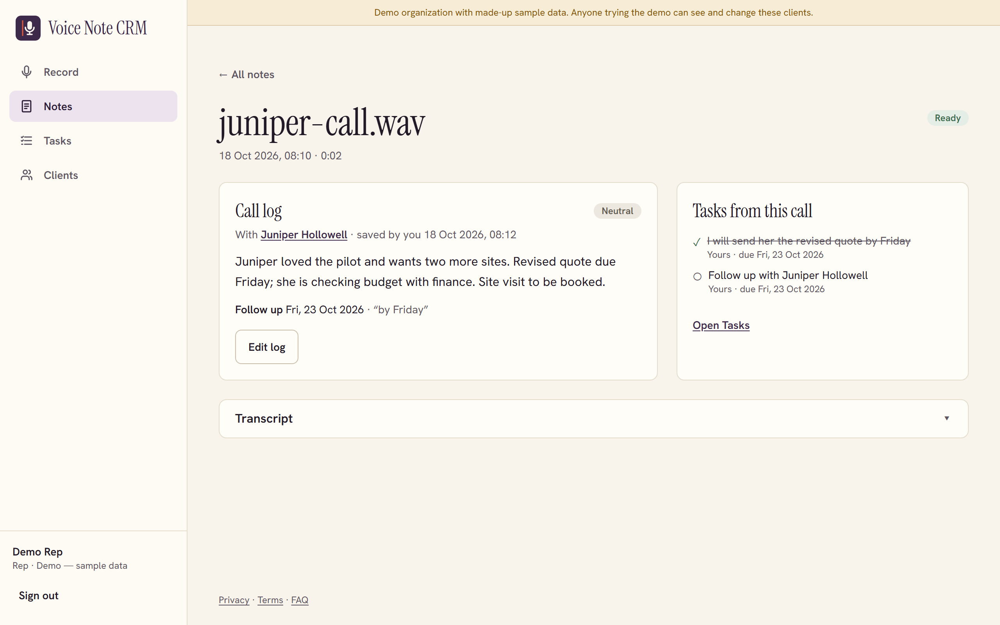
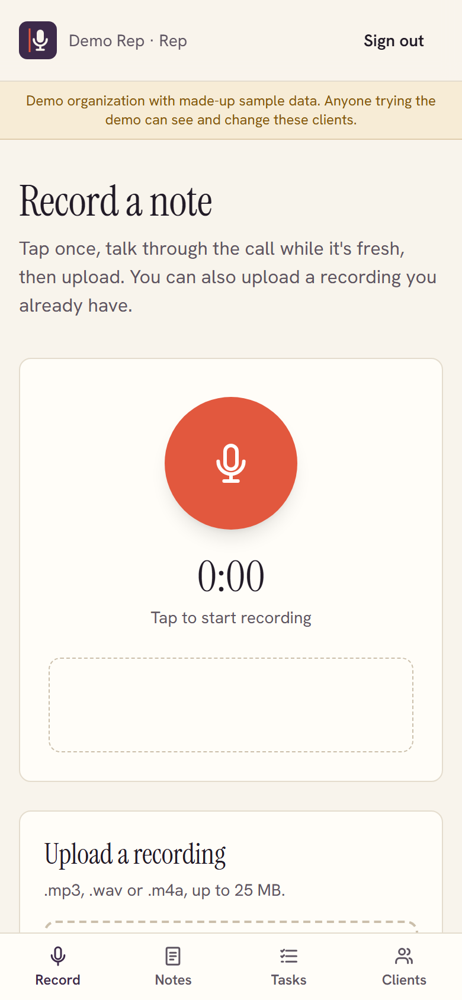
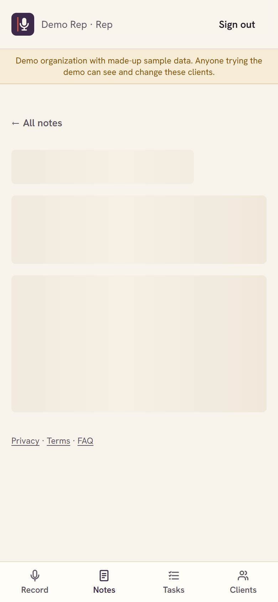
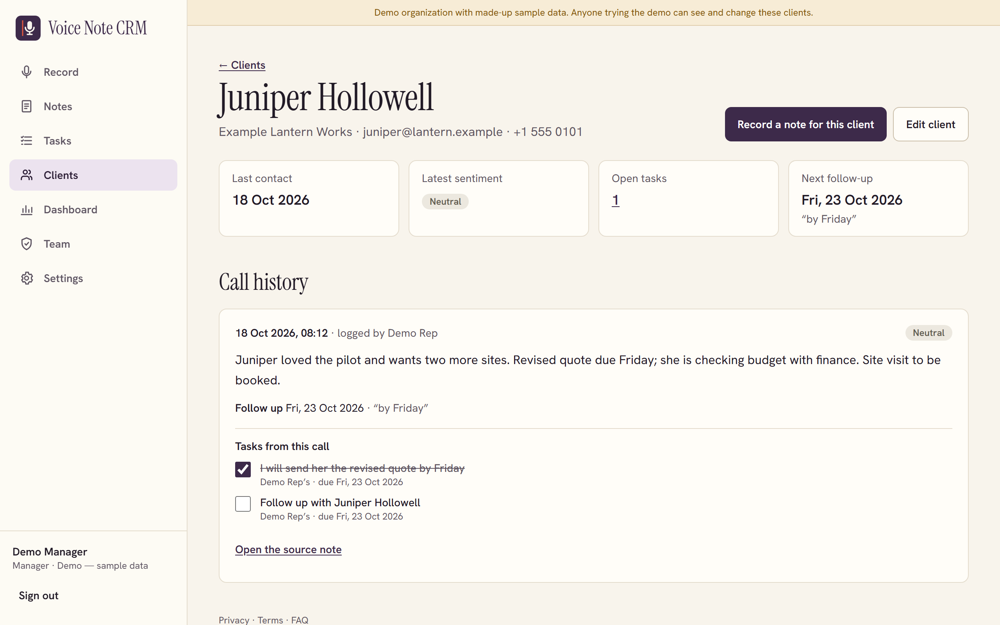
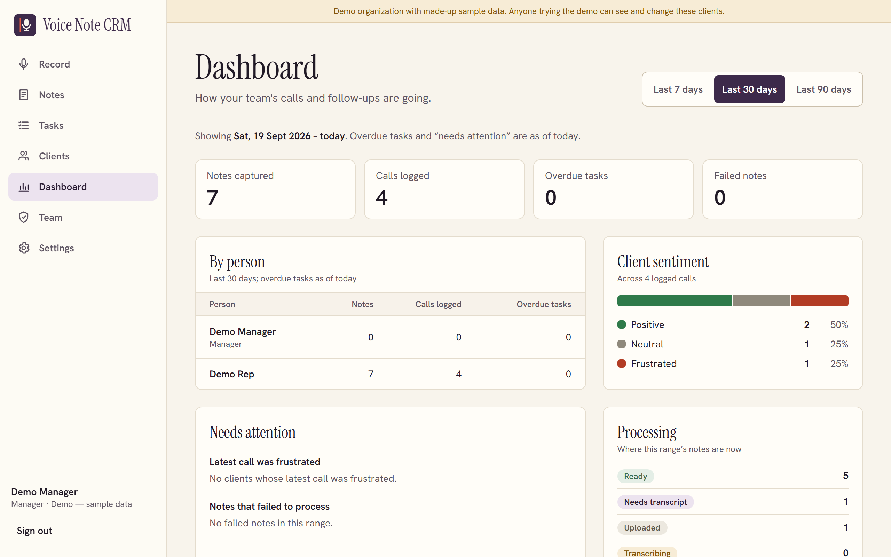

# Voice Note CRM

Voice Note CRM lets a sales rep record a quick spoken debrief after a client call and turns it into a call log: a summary, the client's sentiment, action items, a follow-up date and tasks. The rep checks and edits everything before it is saved, and a manager sees the team's calls, tasks and follow-ups on one dashboard.

**Live demo:** https://voice-note-crm.vercel.app (choose "Try the demo as a rep" or "Try it as a manager"; no sign-up or password needed). The demo is a shared organization with made-up clients, and anything uploaded there is deleted after 24 hours. The API runs on Render's free tier, which sleeps when idle, so the first request after a quiet spell can take about a minute.



## Features

Requirement IDs refer to the project's SRS.

**Capturing a note**
- Record in the browser (WebM/Opus, Ogg/Opus or MP4/AAC, whatever the browser supports) or upload an `.mp3`, `.wav` or `.m4a` file, up to 25 MB
- Start from a client's page to file the note under that client; otherwise the app suggests one from the names mentioned in the note (FR-3.1)
- Offline and flaky-network handling: notes that can't upload yet wait in an on-device queue (IndexedDB) and upload when the connection is back (NFR-5.5)

**Processing**
- Each upload is transcribed and then parsed by queued jobs: `uploaded → transcribing → parsing → ready`, or `failed` with a retry
- Speech to text through any OpenAI-compatible transcription endpoint (Groq's Whisper by default). With no key configured, the note waits in `awaiting_transcript` and the rep types or pastes what was said
- Parsing through any OpenAI-compatible chat model (OpenRouter by default), with a rule-based parser as the fallback whenever there is no key or the model fails. Results say which engine produced them
- The raw transcript is always kept and shown, whatever the parser made of it (FR-2.3)

**Reviewing and saving**
- The parsed note opens as an editable call log: summary, sentiment, action items (rep or client), follow-up date and client (FR-3.2)
- Saving creates the call log and turns action items into tasks in one step (FR-3.3)
- Tasks page with due dates, completion and manual tasks

**Clients and managers**
- Clients list and a per-client timeline of calls, sentiment and tasks
- Manager dashboard over a chosen date range: notes and call logs per rep, overdue tasks, note statuses, sentiment totals, clients whose latest call was frustrated, and failed notes
- Team management for managers (add, edit and deactivate reps) and an organization-wide parsing prompt
- Privacy Policy, Terms of Service and FAQ pages

## Screenshots

All screenshots show the demo organization's made-up sample data.

| Recording on a phone | Review on a phone | Client timeline | Manager dashboard |
|---|---|---|---|
|  |  |  |  |

## Stack

| Part | Technology |
|---|---|
| `api/` | Laravel 13 (PHP 8.4), Laravel Sanctum bearer tokens, SQLite locally and PostgreSQL in production, database queue and cache |
| `web/` | React 19, Vite, Tailwind CSS 4, React Router, plain JavaScript/JSX |

## Architecture

```
Browser (record or upload)
  │  POST /api/voice-notes  (multipart, 25 MB max)
  ▼
API ── encrypts the audio (AES-256-GCM) ──► audio disk (local or S3-compatible bucket)
  │
  ├─ queue: TranscribeVoiceNote ── STT endpoint, or awaiting_transcript when no key
  └─ queue: ParseVoiceNote ─────── LLM endpoint, falling back to the rule-based parser
                                    + client suggestion from names in the transcript
Browser polls GET /api/voice-notes/{id} until the note is ready, then the rep reviews and saves the call log
```

The SRS asks for status updates over WebSockets. This build polls instead, on purpose: every 2 seconds for the first 30 seconds, then every 5, paused while the tab is hidden and stopped once the note settles. A free-tier host can't keep a WebSocket server running, and processing usually takes seconds, so polling gives the same experience with one less moving part. All of it lives in `web/src/lib/noteUpdates.js`, so a broadcast channel (for example Laravel Echo) can replace it later behind the same function.

## Local setup

You need PHP 8.3+ (with `pdo_sqlite`, `mbstring`, `openssl`, `fileinfo`), Composer and Node 20+.

### 1. API

```bash
cd api
composer install
cp .env.example .env
php artisan key:generate
touch database/database.sqlite
php artisan migrate --seed           # --seed creates the demo organization
php -d upload_max_filesize=26M -d post_max_size=27M artisan serve --port=8473
```

PHP's default upload limits (2 MB / 8 MB) are below the app's 25 MB limit, hence the `-d` flags.

In a second terminal, run the queue worker that transcribes and parses notes:

```bash
cd api
php artisan queue:work
```

### 2. Web app

```bash
cd web
npm install
cp .env.example .env.local
npm run dev                          # http://localhost:5473
```

### Tests and checks

```bash
cd api && php artisan test && ./vendor/bin/pint --test
cd web && npm run lint && npm run build
```

## Environment variables

### `api/.env`

| Variable | Purpose |
|---|---|
| `DB_*` | Database connection. `sqlite` locally; for PostgreSQL also `DB_SEARCH_PATH` (the schema, default `public`) and `DB_SSLMODE` (`require` for hosted databases) |
| `FRONTEND_URL` | Origin(s) of the web app, comma-separated. Used for CORS |
| `SANCTUM_EXPIRATION` | API token lifetime in minutes (default 7 days) |
| `DEMO_LOGIN_ENABLED` | Offer the one-click demo sign-in (default `true`) |
| `AUDIO_DISK` | `local` (`storage/app/private/audio`) or `s3` |
| `AWS_ACCESS_KEY_ID`, `AWS_SECRET_ACCESS_KEY`, `AWS_DEFAULT_REGION`, `AWS_BUCKET`, `AWS_ENDPOINT`, `AWS_USE_PATH_STYLE_ENDPOINT` | The bucket for `AUDIO_DISK=s3`. Any S3-compatible storage works, for example Supabase Storage's S3 endpoint |
| `STT_BASE_URL`, `STT_API_KEY`, `STT_MODEL` | Any OpenAI-compatible `/audio/transcriptions` endpoint (default Groq, `whisper-large-v3-turbo`). Empty key: notes wait for a typed transcript |
| `LLM_BASE_URL`, `LLM_API_KEY`, `LLM_MODEL` | Any OpenAI-compatible chat completions endpoint (default OpenRouter and a free model). Empty key: rule-based parsing |
| `CRON_SECRET` | Shared secret for `POST /api/cron/run` (see below). Empty disables the endpoint |
| `DB_QUEUE_RETRY_AFTER` | Seconds before a running queue job is considered lost. Set it above the jobs' 120-second timeout (for example `180`) |

### `web/.env.local`

| Variable | Purpose |
|---|---|
| `VITE_API_URL` | Base URL of the API, including `/api` |

## Demo accounts

There are no demo passwords. `php artisan db:seed` creates a demo organization with a manager, a rep and six made-up clients; the "Try the demo" buttons sign in as one of them through `POST /api/demo/login`. The demo accounts have random passwords that are never stored or shown. Set `DEMO_LOGIN_ENABLED=false` to turn the demo off.

Because the demo is shared, `voice-notes:prune-demo` deletes demo-organization notes (with their audio and call logs) and tasks older than 24 hours. It runs hourly on the Laravel scheduler (`php artisan schedule:work`, or `* * * * * php artisan schedule:run`). On hosts without cron, the `Demo cleanup` GitHub Actions workflow calls `POST /api/cron/run` hourly with `Authorization: Bearer $CRON_SECRET`; set the repository variable `API_URL` and secret `CRON_SECRET` to enable it.

## Deploying

### API

`api/Dockerfile` builds a production image (FrankenPHP, PHP 8.4, OPcache, `pdo_pgsql`, 26 MB upload limit) that listens on `$PORT` (default 8080). It sets `APP_ENV=production`, `APP_DEBUG=false` and logs to stderr; it contains no secrets, so set `APP_KEY`, the `DB_*` variables and the others above in the host's environment. On every start, `api/docker/start.sh` caches config and routes, runs `php artisan migrate --force`, switches on row level security for every table when the database is PostgreSQL (`php artisan db:enable-rls`), seeds the demo organization if it is missing, starts a queue worker and then the web server.

The live API runs at `https://voice-note-crm-api.onrender.com` as a Render Docker web service (root directory `api`, free plan, Singapore region, health check `GET /api/health`, deploys on every push to `main`). Its database is a dedicated `voice_note_crm` schema in a Supabase PostgreSQL project, reached through the session pooler with `DB_SSLMODE=require`.

For PostgreSQL in a dedicated schema of a shared database, give the app its own login role that owns the schema, with no access granted to other roles, and set `DB_SEARCH_PATH` to that schema. The app role owns its tables, so row level security does not restrict it, while every other role is denied.

### Web app

The web app is deployed on Vercel at `https://voice-note-crm.vercel.app` (project root `web`, Vite preset, deploys on every push to `main`) with `VITE_API_URL=https://voice-note-crm-api.onrender.com/api`. If the site is deployed elsewhere, replace the address in `web/src/lib/site.js`, `web/index.html` (canonical and social tags), `web/public/robots.txt` and `web/public/sitemap.xml`.

`web/vercel.json` sets a Content-Security-Policy whose `connect-src` allows `'self'` and the API origin. If the API moves, update that origin, or the app cannot reach the API.

## Security

- Audio is encrypted with AES-256-GCM before it is stored, with a key derived from `APP_KEY` and the storage key bound in as associated data. Transcripts, parsed results, call summaries and task titles are encrypted at rest. Rotating `APP_KEY` makes existing notes unreadable
- Every record is scoped to the user's organization, reps only see their own notes, and manager-only routes are enforced on the server
- On PostgreSQL the app uses its own schema-owning role, with row level security on every table
- Rate limits on sign-in, the demo, uploads, processing and the API as a whole

See [SECURITY.md](SECURITY.md) to report a vulnerability.

## Known limitations

- **No speech-to-text or AI keys on the live demo yet.** Until `STT_API_KEY` and `LLM_API_KEY` are set on the API, recorded notes stop at "awaiting transcript" (type or paste what was said) and are parsed by the rule-based parser, which is much simpler than a model
- **Audio on the live demo is not durable.** It is stored encrypted on the API host's disk, which Render wipes on every deploy or restart, so older demo notes lose their audio playback (the transcript and call log remain). Setting `AUDIO_DISK=s3` with bucket keys fixes this
- **Cold starts.** The free Render instance sleeps after about 15 minutes idle; the first request then takes up to a minute
- **The SRS target of processing a note within 15 seconds (NFR-5.1) has not been measured** against real transcription and model endpoints
- **The app itself does not work offline from a cold start.** Notes recorded while the connection drops are queued and uploaded later, but there is no service worker, so the app can't be opened with no connection at all
- Status updates use polling rather than WebSockets (see Architecture)

## License

Free for personal, educational and other noncommercial use under the [PolyForm Noncommercial License 1.0.0](LICENSE). Third-party fonts and assets are listed in [CREDITS.md](CREDITS.md).

## Commercial use

Using Voice Note CRM for commercial purposes requires a paid commercial license. Contact fazalabbas2002@gmail.com.
